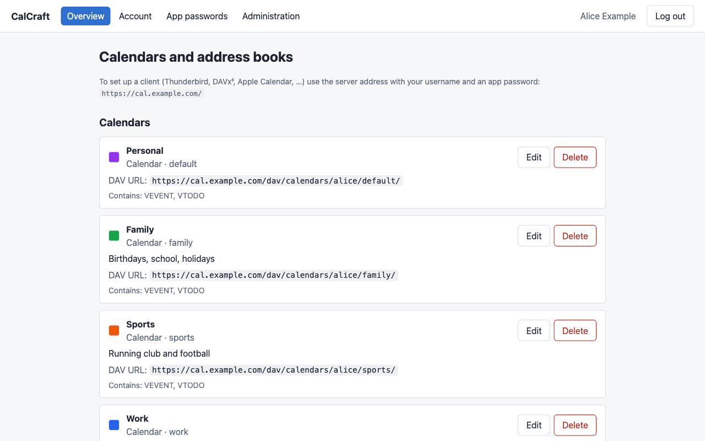
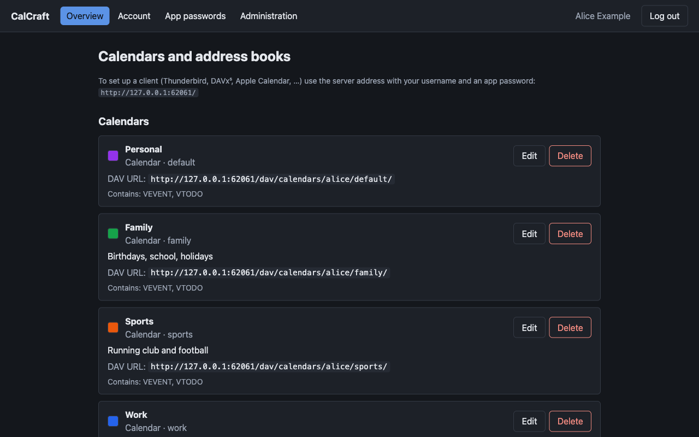
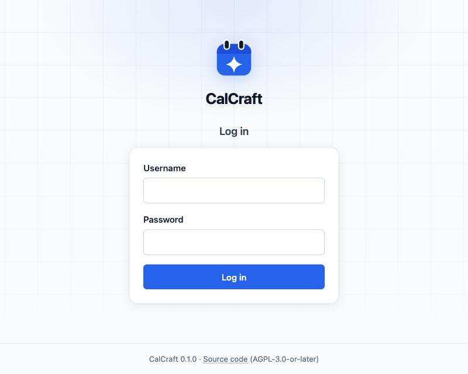
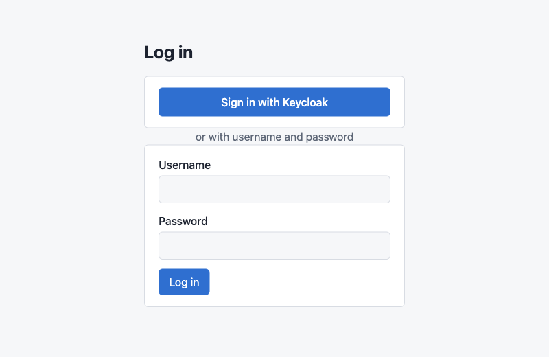
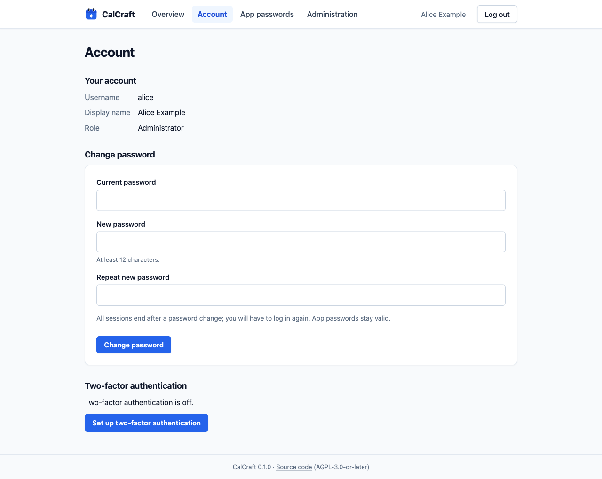
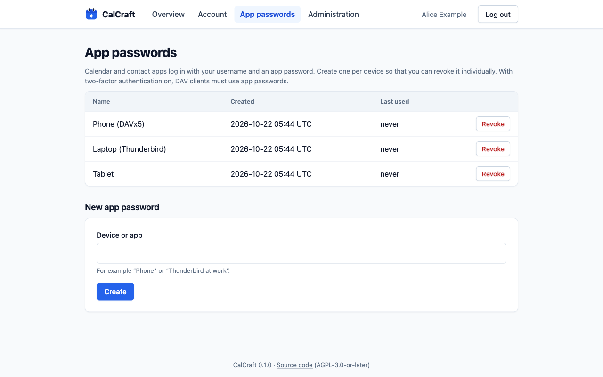
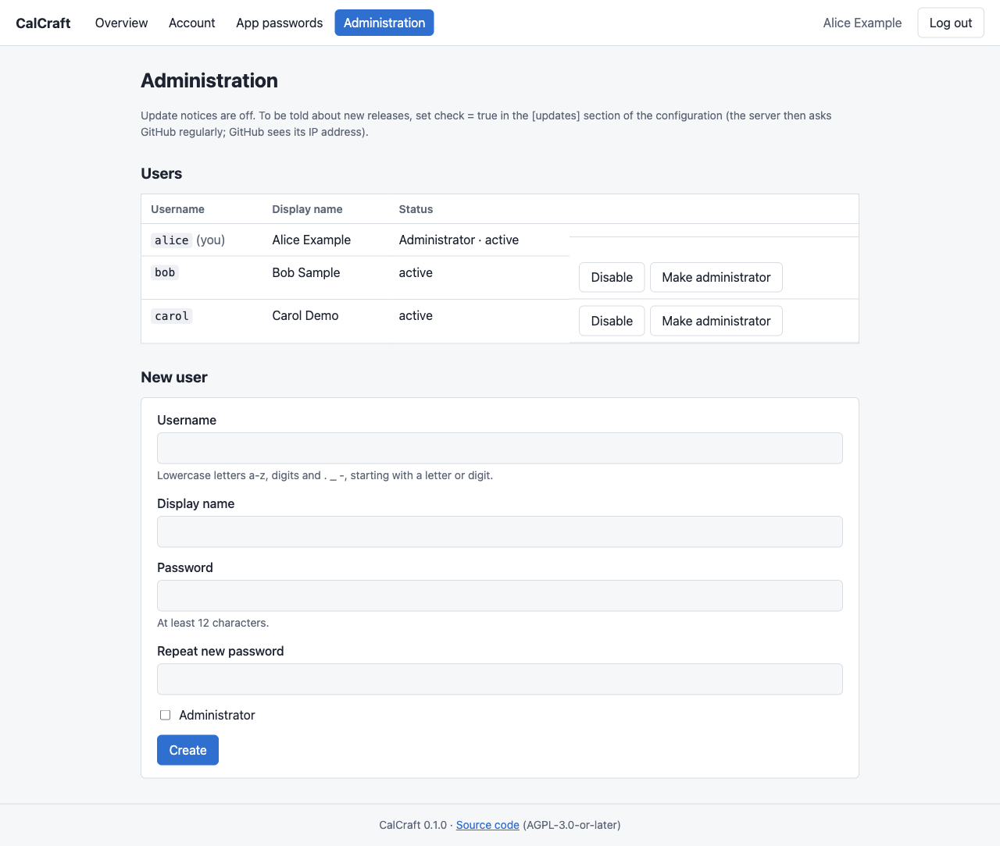
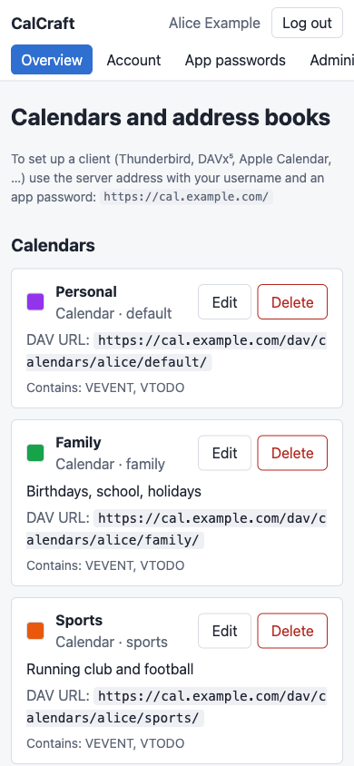

# CalCraft

Self-hosted CalDAV/CardDAV server written in Rust, with an optional web interface.

> **Status:** early development (milestone M4: REST API and first web UI). Not ready for production use.

## Goals

- Standards-compliant CalDAV (RFC 4791) and CardDAV (RFC 6352)
- Security first: no `unsafe`, audited dependencies, fuzzed parsers, strict defaults
- Single binary, optional Docker image
- Optional web UI (Leptos) and REST API with OpenAPI – both can be disabled
- Local users or SSO via OpenID Connect (e.g. Keycloak), with per-device app passwords
- Support for iCalendar, jCal, xCal, vCard 3/4, jCard, CSV and webcal subscriptions

See [PLAN.md](PLAN.md) for the roadmap.

## Screenshots

The optional web UI, shown with fictional demo data:

| | |
|---|---|
| <br>Calendars and address books with their DAV URLs | <br>Dark mode follows the system setting |
| <br>Login with username and password | <br>Login with single sign-on (OpenID Connect) enabled |
| <br>Account: password and two-factor authentication | <br>One app password per device, revocable individually |
| <br>Administration: users and update notice | <br>Phone-width layout |

## Building

```sh
cargo build --release
```

Cargo features of `calcraft-server`:

| Feature | Default | Description |
|---|---|---|
| `web-ui` | yes | Embedded web interface |
| `api` | yes | REST API |
| `oidc` | yes | Single sign-on via OpenID Connect (implies `api`; adds an HTTPS client: rustls/ring) |
| `update-check` | yes | Optional update notice for administrators (implies `api`; same HTTPS client; off unless `[updates] check = true`) |

CalCraft runs on Linux, macOS and Windows.

### Web UI

The web interface is a Leptos application (`crates/calcraft-ui`) compiled to
WebAssembly. Its files are embedded into the server binary at build time, so
build them first:

```sh
rustup target add wasm32-unknown-unknown                   # listed in rust-toolchain.toml
cargo install wasm-bindgen-cli --version 0.2.114 --locked  # must match crates/calcraft-ui/Cargo.toml
scripts/build-ui.sh                                        # Windows: scripts/build-ui.ps1
cargo build --release
```

Without these assets the server still builds but shows a placeholder page on `/`;
set `CALCRAFT_UI_REQUIRED=1` to make missing assets a build error. No npm or other
JavaScript tooling is needed.

The UI covers login (with two-factor codes), calendars and address books, account
settings (password, TOTP), app passwords and user administration. Disable it at
runtime with `web_ui.enabled = false` or `calcraft serve --no-web-ui`.

Minimal DAV-only build:

```sh
cargo build --release -p calcraft-server --no-default-features
```

## Installation

A step-by-step guide for production setups — DNS records, build or Docker,
systemd service, TLS with Let's Encrypt and ready-to-use **nginx** and
**Apache** configurations — is in [docs/installation.md](docs/installation.md).

Released binaries (Linux, macOS, Windows) and the Docker image
`ghcr.io/zeitgleich/calcraft` come with SHA-256 checksums, build provenance
attestations and a keyless cosign signature; how to check them is described in
[docs/release-verification.md](docs/release-verification.md). Maintainers: see
[docs/releasing.md](docs/releasing.md) and [CHANGELOG.md](CHANGELOG.md).

## Running

Create a user (the password is prompted for, or read from stdin with `--password-stdin`;
it is never accepted as an argument):

```sh
calcraft user add alice --display-name "Alice"
```

Start the server:

```sh
calcraft serve --config calcraft.toml
```

Point your client at `https://your-host/` – discovery via `/.well-known/caldav` and
`/.well-known/carddav` leads to `/dav/`. Always run CalCraft behind TLS: DAV clients
use HTTP Basic authentication.

Other user commands: `calcraft user list|passwd|disable|enable|set-admin|allow-sso-link|unbind-sso`
(`calcraft user add alice --admin` creates an administrator).

### Request limits and reverse proxies

CalCraft rejects excess requests immediately instead of queueing them:

- at most `server.max_concurrent_requests` (256) requests at the same time, further
  ones get `503` with `Retry-After` (`/healthz` and `/readyz` are exempt);
- per client 32 concurrent requests and a token bucket of 120 requests, refilled with
  20 per second (`429` with `Retry-After`);
- per client 20 failed logins in 15 minutes (DAV, web UI, second factor; known and
  unknown usernames), in addition to the lockout per account (5 in 15 minutes).
  Further logins from that client fail exactly like wrong credentials.

IPv6 clients count per /64 (`client_ipv6_prefix`). The per-client tables are capped
(`max_tracked_clients`, idle entries are evicted), so address hopping cannot exhaust
memory. Blocked entries are never evicted; if an attacker fills the table with
blocked networks (cheap with IPv6), new clients are not counted per client until
those entries expire, and only the per-account lockout applies. The client is the
TCP peer address; `X-Forwarded-For` is only used when the
peer is listed in `server.trusted_proxies`, read from the right and skipping trusted
proxies, so entries a client adds itself are ignored. The default
`["127.0.0.1/32", "::1/128"]` fits a reverse proxy on the same host; a local process
could then choose its client address, set `[]` if that matters. A proxy on another
host or a Docker bridge must be listed, otherwise all users share the proxy's limits;
CalCraft logs a warning once when it ignores `X-Forwarded-For` (see
`docs/installation.md`).

### Backups and upgrades

```sh
calcraft backup /var/backups/calcraft-$(date +%F).db   # online, while the server runs
calcraft restore --yes /var/backups/calcraft-2026-10-21.db   # server stopped
```

Before applying database migrations, CalCraft writes a backup
`calcraft.db.pre-migration-<version>-<timestamp>` next to the database (the last 3
are kept). Migrations are forward-only; to roll back an upgrade, restore that
backup with the previous version. Details in
[`docs/backup-and-upgrade.md`](docs/backup-and-upgrade.md).

Optionally, the admin area shows a notice when a new release is out:

```toml
[updates]
check = true          # default: false
interval_hours = 24   # 1-168
```

CalCraft then requests `https://api.github.com/repos/Zeitgleich/CalCraft/releases/latest`
at startup and every `interval_hours` (plain `GET`, no cookies, no credentials, nothing
about your installation). GitHub sees the server's IP address and the User-Agent
`calcraft/<version>`. Drafts and pre-releases are ignored; the result is kept in memory
only and is also available as `GET /api/v1/admin/update`.

### App passwords and two-factor authentication

Each device should get its own app password (`ccap_…`), created
in the web UI (or via `POST /api/v1/app-passwords`) and revocable individually.
Once two-factor authentication (TOTP) is enabled for an account, DAV clients must
use app passwords; the account password then only works together with a code.

The REST API is described in `/api/openapi.json`.

### Single sign-on (OpenID Connect)

The web UI can log in via any OpenID Connect provider (Keycloak, Authentik, Zitadel,
Entra ID, …) using the Authorization Code flow with PKCE. DAV clients cannot do OIDC,
so SSO users create app passwords for their devices.

Keycloak example: create a client `calcraft` in realm `main` (Client authentication
on, Standard flow only), set the valid redirect URI to exactly
`https://cal.example.com/api/v1/auth/oidc/callback` and copy the client secret.
For admin rights from a group, add a *Group Membership* mapper (claim `groups`,
"Add to ID token" on; full group path gives values like `/calcraft-admins`).

```toml
[oidc]
enabled = true
issuer = "https://keycloak.example.com/realms/main"
client_id = "calcraft"
# Secret via file or CALCRAFT_OIDC__CLIENT_SECRET instead of the config file:
client_secret_file = "/run/secrets/calcraft-oidc"
redirect_uri = "https://cal.example.com/api/v1/auth/oidc/callback"
scopes = ["openid", "profile"]
username_claim = "preferred_username"
# Optional: admin rights follow this group (granted and revoked on each login).
admin_claim = "groups"
admin_value = "/calcraft-admins"
# Create unknown users on first login (default: an admin creates them first).
auto_create_users = false
button_label = "Sign in with Keycloak"
```

How accounts are matched:

- The configured claim (default `preferred_username`) must be a valid CalCraft
  username after lowercasing (and optionally removing `username_strip_suffix`, e.g.
  `@example.com` for UPNs); it is never rewritten. E-mail addresses are never used.
- Accounts created via SSO (`auto_create_users`) are bound to the IdP identity
  (issuer + subject) at creation. An **existing** local account is never linked just
  because the name matches: an operator approves exactly one IdP account with
  `calcraft user allow-sso-link <user> --subject <sub> [--hours 1]` (the subject is the
  user's ID in the IdP admin console, e.g. Keycloak's user ID; valid 1 h by default, at
  most 24 h). Only the next SSO login with that issuer + subject binds the account and
  consumes the approval; any other IdP account with the same name fails with
  `account_exists` and leaves the approval in place.
- Once bound, logins must present the same subject, so a different IdP account with
  the same username cannot take over. `calcraft user unbind-sso <user>` resets it.
- The IdP should not let users choose their username freely (open self-registration),
  otherwise someone can claim a name before its owner does. If it does, restrict SSO
  with `required_claim`/`required_value` (e.g. a group only admins assign).
- Disabled accounts cannot log in. Accounts created via SSO have no usable password
  until an administrator sets one (`calcraft user passwd`).
- By default SSO logins do not ask for the local TOTP code: MFA is the IdP's job.
  With `require_local_totp = true`, accounts with local 2FA cannot use SSO
  (`local_2fa_required`).
- `[security] password_login = false` makes SSO the only interactive login: the
  password login API and DAV Basic auth with the account password are refused, app
  passwords keep working; changing the password and local 2FA setup are refused too
  (`password_login_disabled`). CalCraft refuses to start this way without `[oidc]`.
- Pending logins are kept in a bounded table (oldest evicted); the per-client request
  limits (see above) also apply to the SSO endpoints. Failed SSO callbacks do not
  count as failed logins (they involve no guessable secret).

The UI learns whether SSO is available from `GET /api/v1/auth/methods`. Errors are
reported by redirecting to `/?sso_error=<code>`. Discovery, JWKS and token endpoints
must be https on the issuer's host (`extra_endpoint_hosts` allows more, e.g. Google's
`www.googleapis.com`); the system trust store is used, `ca_file` adds a private CA.

To try it against a real Keycloak locally (verified with Keycloak 26.4):

```sh
docker run --rm --name kc -p 127.0.0.1:8080:8080 -e KC_BOOTSTRAP_ADMIN_USERNAME=admin \
  -e KC_BOOTSTRAP_ADMIN_PASSWORD=admin quay.io/keycloak/keycloak:26.4 start-dev
```

In the admin console (`http://127.0.0.1:8080`, admin/admin) create realm `main`, the
client as above with redirect URI `http://localhost:5232/api/v1/auth/oidc/callback`,
and a user. Then run CalCraft with `issuer = "http://127.0.0.1:8080/realms/main"`,
that redirect URI, `[security] secure_cookies = false` and
`allow_insecure_issuer_for_testing = true` (plain HTTP – never in production), open
`http://localhost:5232/api/v1/auth/oidc/login` and log in. Use the same host name for
the issuer everywhere: Keycloak derives `iss` from the URL it is called with.
Stop the container with `docker stop kc`.

### Import and export

Calendars can be exported and imported as iCalendar (`ics`), jCal (`jcal`), xCal
(`xcal`) and CSV (`csv`); address books as vCard 3.0/4.0 (`vcf`), jCard (`jcard`) and
CSV. On the command line:

```sh
calcraft export --user alice --collection calendar/default --format ics > alice.ics
calcraft import --user alice --collection calendar/default --format ics alice.ics
calcraft import --user alice --collection addressbook/default --format csv \
    --on-conflict replace contacts.csv     # `-` reads standard input
```

Via the REST API (session cookie; `import` needs the `X-CalCraft-Request` header):
`GET /api/v1/collections/{kind}/{slug}/export?format=…` and
`POST /api/v1/collections/{kind}/{slug}/import?format=…&on_conflict=skip|replace`
with the file as body. The import answers with counts of created, replaced, skipped
and rejected objects and the reasons for the first 20 rejections.

Every imported object is validated exactly like a CalDAV/CardDAV upload, and the
storage quota and object limits apply. Files may have at most 20 MiB and 10 000
objects; via HTTP the global `server.max_body_bytes` (10 MiB by default) applies
as well, so import larger files with the CLI. The converted objects may take at most
four times the file size (64 MiB at most), which bounds the copies of time zones.
Events are grouped by UID together with their recurrence overrides, and
the referenced time zones are copied into each object. Objects whose UID already
exists in the collection are skipped unless `on_conflict=replace` is given.

CSV columns are `summary,start,end,all_day,location,description,uid` for events and
`name,emails,phones,org,uid` for contacts (several values separated by `;`). CSV
exports hold events only (the master of a recurring event, without its rule), and
cells starting with `=`, `+`, `-`, `@`, TAB or CR are prefixed with `'` so that
spreadsheets do not evaluate them; the import removes this prefix again.

See [`calcraft.example.toml`](calcraft.example.toml). Every setting can be overridden via
environment variables with the prefix `CALCRAFT_` and `__` as separator,
e.g. `CALCRAFT_SERVER__BIND=0.0.0.0:5232`.

## Security

Please report vulnerabilities privately, see [SECURITY.md](SECURITY.md).

## License

CalCraft is licensed under the [GNU Affero General Public License v3.0 or later](LICENSE).
